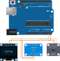

# ArduVP

ArduVP is a virtual twin of an Arduino Uno, allowing you to develop and test software virtually,
before moving on to real hardware.

## Building

ArduVP follows a typical CMake build flow.

First clone, including submodules:

```bash
git clone --recurse-submodules https://github.com/not-chciken/ArduVP
```

Then build:

```bash
mkdir build
cd build
cmake .. -DCMAKE_BUILD_TYPE=RELEASE
cmake --build . -j $(nproc)
```

## Launching ArduVP

ArduVP can be launched by providing a configuration file.
For example, the "Hello World!" example can be launched with:

```bash
cd build
./arduvp -f ../sw/hello_world/hello_world.cfg
```

## Example Software

The `sw` directory contains a comprehensive set of example software,
covering everything from terminal output to text scrolling on the SSD1306 screen.
Since ArduVP aims to be functionally equivalent to the real hardware board,
any software for the Arduino Uno can run unmodified.
In case you want to run your own software, take any of the configurations in `sw` as an example, and put your software as an ELF file next to it.

## Modeled System

By default, ArduVP includes an SSD1306 screen and an ADS1015 analog-digital converter attached to its I2C bus:



| Device      | I2C Address |
|-------------|-------------|
| SSD1306     | 0x3c        |
| ADS1015     | 0x48        |
| EEPROM 24xx | 0x50        |

However, with ArduVP being based on [VCML](https://github.com/machineware-gmbh/vcml),
any kind of system can be set up.
Simply adapt `src/system.h` with the models you need.

## Advanced Configuration

The analog pins of the board can be set to a given voltage via properties in the configuration file.
For example:
```
system.volt_pin_a=0.42 1.337 6 0.01 2.3 0
```
Serial output can be redirected.
For example:
```
system.serial.backends = stdout          # print to stdout
system.serial.backends = file:serial.txt # write to a file
system.serial.backends = null            # discard
```

Bus traffic, serial output, I2C messages, and other things can be traced.
Enable the `trace` property for a given module, and append `--trace-stdout`.
For example:

```bash
./arduvp -f ../sw/serial/hello_world/hello_world.cfg -c system.atm328p.usart.trace=true --trace-stdout
```

Similarly, debug logging can enabled as follows:
```bash
./arduvp -f ../sw/ssd1306/text_scroll/text_scroll.cfg -c system.ssd1306.loglvl=debug --log-debug
```

By default, the simulation runs as fast as it can, but it cannot be faster than wall-clock time.
If you need more a nuanced setting, use the system's throttle.
For example, an RTF of 2 allows the system to be twice as fast as wall-clock time:
```
system.throttle.rtf = 1.0
```
Note that this is just a maximum.
At one point your host computer's will likely become the determining factor.
